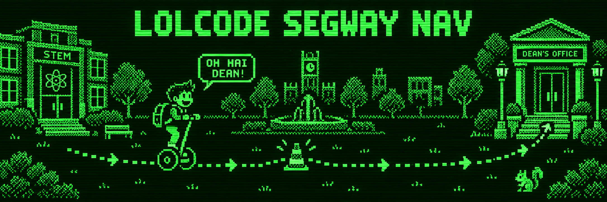

# LOLCODE Segway Navigation



A Segway navigation simulator written in LOLCODE: from the STEM building
to the dean's office. OH HAI DEAN.

## Teh very official campus route

Start at the STEM building facing north, then follow this entirely fictional
185-meter route:

| Leg | From → to | Heading | Distance |
| --- | --- | --- | --- |
| 1 | STEM building → quad | West (270°) | 40 m |
| 2 | Quad → admin hall | North (0°) | 120 m |
| 3 | Admin hall → dean's office | East (90°) | 25 m |

A pretend obstacle interrupts each leg, the pretend Segway waits, and then it
continues its extremely important academic mission. The last stop is the dean's
office. No campus map, Arduino, or actual dean required—just run `./run.sh` to
watch the commands scroll by.

## How it works

The LOLCODE program is the "brain," running on a laptop or Raspberry Pi under
[lci](https://github.com/justinmeza/lci). It prints one plain-text motor command
per line to stdout. An Arduino-side sketch would read these commands over serial
and drive the motors; that sketch has not been written yet.

| Command | Meaning |
| --- | --- |
| `TURN <deg>` | Rotate in place. Positive is clockwise. |
| `DRIVE <ticks>` | Roll forward that many wheel encoder ticks (120 per meter). |
| `MOTOR 0 0` | Stop both motors. |
| `ESTOP` | Emergency stop, cut power. |

Lines starting with `BTW` are log messages. The Arduino sketch should ignore them.

## Safety logic

The program sends a stop command and waits when sonar reads under 50 cm. If tilt
exceeds 15 degrees, it sends `ESTOP` and aborts. These checks currently use simulated
sensor readings, so they do not provide real hardware protection.

## Running it

Use Bash on Linux, a Raspberry Pi, macOS, or Windows with WSL. Install
[lci](https://github.com/justinmeza/lci), then run:

```bash
./run.sh
```

If `lci` is not on your `PATH`, the helper reuses `./lci/lci` or clones and builds
the interpreter into `./lci/`. Building requires Git, CMake, Make, and C/C++ compilers
with their standard development libraries, plus Readline and ncurses development
libraries (`libreadline-dev` and `libncurses-dev` on Ubuntu). Build messages go to stderr so stdout
contains only the program's output.

Once an Arduino command parser and real hardware integration exist, send output
to its serial port with an installed `lci`:

```bash
lci segway_nav.lol > /dev/ttyACM0
```

The port varies by machine; its serial settings must match the Arduino sketch.

## Limitations

- **The route is fictional on purpose.** The three legs' headings and distances
  are made up for the joke, not measured on a real campus. Edit the three `ROLL`
  calls at the bottom of the file to invent your own campus adventure.
- **The sensors are simulated.** `SNIFF` returns a fake sonar distance and
  `WOBBLE` returns a fake tilt. The obstacle-wait loop also simulates clearance.
  Real hardware needs two-way serial, which is awkward in LOLCODE because its
  only input is `GIMMEH` from stdin.
- **The Arduino command-parsing sketch does not exist yet.** This repository
  demonstrates command generation; it is not a complete Segway controller.

## Sample output

The first 12 lines and last 3 lines from an actual run are shown below. The
ellipsis marks omitted output.

```text
BTW LEG 1 STEM BILDING 2 QUAD
TURN -90
DRIVE 120
DRIVE 120
DRIVE 120
DRIVE 120
DRIVE 120
DRIVE 120
DRIVE 120
MOTOR 0 0
BTW OH NOES, SUMTHIN 30 CM AHED. WAITIN.
DRIVE 120
...
DRIVE 120
MOTOR 0 0
BTW I HAS ARRIVD. OH HAI DEAN. KTHX.
```

## Fun fact

In lci, a `WILE`/`TIL` loop condition requires a counter such as `UPPIN YR x`.
The obstacle-wait loop instead uses an explicit `O RLY?` check and `GTFO` to break.

## License

MIT. Copyright 2026 Zack Bolich.
